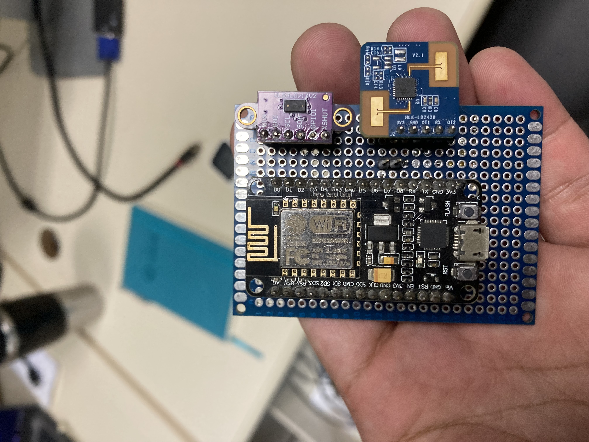

# 🌐 SAPAV-IoT

> IoT-based edge telemetry and preventive alert system for detecting Vulnerable Road Users (VRUs) at pedestrian crossings, integrated with Digital Twins.

---

## 🚀 About the Project

**SAPAV-IoT** is a project developed to integrate embedded devices with the cloud/internet, enabling real-time monitoring, sensor data collection, and remote, automated actuator control. The system operates on an *Edge-Gateway* topology, delegating the physical noise filtering of a millimeter-wave radar to a sensor node and concentrating the semantic network encapsulation in a gateway for data persistence in Smart City platforms.

---

## 🛠️ Technologies and Tools Used

The project uses the following technologies and libraries:

- **Hardware:** ESP8266 NodeMCU (Sensor Node), Raspberry Pi 4 (IoT Gateway), HLK-LD2420 mmWave Radar Sensor (24 GHz).
- **Language:** C++ (Edge firmware with `SoftwareSerial`), Python 3 (Gateway scripts with `pyserial` and `requests`).
- **Communication:** UART at 115200 bps (Sensor ↔ ESP8266), Serial USB (ESP8266 ↔ Gateway), HTTP POST REST (Gateway ↔ Cloud).
- **Platform / Cloud:** FIWARE Orion-LD (Local Context Broker), ETSI NGSI-LD Standard, Reverse SSH Tunnel (Pinggy).

---

## ⚙️ Key Features

* **Edge Computing:** Deadband filter (5 cm) and edge-triggered detection implemented directly on the microcontroller to suppress thermal noise and reduce redundant network traffic.
* **Optimized Latency:** Structured data transport with non-blocking throttling, delivering a median response time (RTT) of 30 ms and 0% packet loss.
* **Digital Twin Integration:** Automated conversion of raw physical data into structured semantic attributes ready for consumption and spatial mapping.

---

## 📂 Repository Structure

```text
SAPAV-IoT/
├── Codigo/                    # Source codes (ESP8266 C++ firmware and Gateway Python scripts)
├── Estudos/                   # Theoretical documentation on FIWARE architecture, NGSI-LD, and Digital Twins
├── Hardware/                  # Integration diagrams, corrected LD2420 pinout, and circuits
├── Projeto_sinal_cidade_inteligente/ # Structural logic of actuators and spatial modeling of intersections
├── documentacaoDiariaETestes/ # Oscilloscope analyses, polling scripts, and load test results (CSVs)
└── README.md                  # Main project documentation



